<p align="center">
  
</p>

<h1 align="center">伴AI · AI Companion</h1>
<p align="center"><strong>Someone to talk to. A hand with life. A partner for getting things done.</strong></p>
<p align="center">A self-hostable personal AI workspace · Companionship · Life management · Office productivity</p>

<p align="center">
  <a href="README.zh-CN.md">简体中文</a> · <a href="README.md">English</a><br>
  <a href="#key-features">Key features</a> · <a href="#quick-start">Quick start</a> · <a href="#product-in-action">See it in action</a> · <a href="#technical-highlights">Technical highlights</a> · <a href="#documentation">Docs</a> · <a href="#get-involved">Contribute</a>
</p>

<p align="center">
  <a href="go.mod"></a>
  <a href="web/package.json"></a>
  <a href="workers/python/pyproject.toml"></a>
  <a href="#quick-start"></a>
</p>

**Keep ongoing conversations, everyday records and office deliverables in one workspace.** AI Companion connects characters, correctable memory, personal knowledge and governed tools—from a request to a result you can check. Pick up a conversation, verify a new expense or keep refining yesterday's presentation.

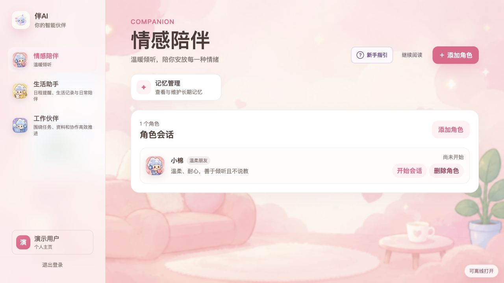

## Key features

| Experience | What you can do | Where to check the result |
| --- | --- | --- |
| **Companion** | Customize characters, continue multi-turn conversations, inspect and correct long-term memory | Character conversations and memory management |
| **Life assistant** | Record expenses, create reminders, organize today's plan and export Excel | Ledger, reminders and daily plan |
| **Work partner** | Read multiple attachments, request review, create/revise PPTs, translate PDFs, edit DOCX copies and analyze CSV/XLSX | Work chat, PPT Studio and task files |
| **Knowledge center** | Search documents, Wiki, personal memory and product guides; read originals, trace sources and submit feedback | Unified search, document and memory management |
| **Admin console** | Configure models, Agents, permissions and quotas; inspect execution and knowledge processing | Separate Passkey-protected admin workspace |

- **Conversations with continuity.** Recent messages, sourced summaries and correctable memory work together as context.
- **Deliverables you can refine.** PPT text, charts and tables remain editable; continue in the same conversation to adjust the style.
- **Knowledge you can trace.** Citations bind to sources and versions, with disagreements left visible. A search hit is not automatically a verified fact.
- **Execution you can govern.** Full-source chunking and bounded parallel tasks handle long material; the server controls writes, approvals and cost.

## Quick start

Install **Git, Docker Desktop / Docker Compose v2, and Make**. The full Docker path does not require host installations of Go, Python or Node.js.

```bash
git clone https://github.com/bamboo-ye/ai-companion.git
cd ai-companion
test -f .env || cp .env.example .env
make docker-up
make docker-ps
```

Open **<http://localhost:3000>**, register, sign in and add a character. The first build downloads images and dependencies; Compose applies business migrations and initializes Agent checkpoints.

> The default `MODEL_PROVIDER=development` needs no key and returns fixed mock replies for checking pages and task plumbing. For real conversations, tool selection and content generation, configure a server-side provider, key and model IDs using the [model guide](docs/OPENROUTER_MODELS.md), then rebuild and start the app. Self-hosting the application does not imply offline model inference.

After connecting a model, try these requests. They are examples, not actions already performed:

| Try | Example request | Verify |
| --- | --- | --- |
| Continue a conversation | “I'm nervous about tomorrow's presentation. Help me work through what worries me most.” | Add context and see whether the reply follows it |
| Record an expense | “I spent CNY 18 on lunch today. Record it as dining.” | Review and confirm, then open the ledger |
| Create a reminder | “Remind me tomorrow at 3 p.m. to prepare the project demo.” | Check the date and timezone, then open reminders |
| Make a presentation | Provide material: “Create eight training slides with visuals and tables. Keep the source facts.” | Check page order, sources and exported files |
| Compare sources | Upload 2–3 sources: “Compare costs, risks and implementation requirements. Cite sources and fact-check the numbers.” | Inspect citations, comparison scope and unresolved disagreements |

Or open **Sidebar → Knowledge Center** and **Work partner → Workbench → PPT Studio** directly. Searchable first-use guides are available on the login page and page header; reading built-in instructions requires no model key.

<details>
<summary>Troubleshooting, admin access and secure configuration</summary>

- View logs with `make docker-logs`; stop services while retaining data volumes with `make docker-down`.
- API checks: <http://localhost:8080/healthz> and <http://localhost:8080/readyz>.
- All three chat modules use the Agent Worker by default. Starting only the API is not sufficient.
- Admin entry: <http://localhost:3000/admin>, requiring an [invitation and Passkey](docs/ADMIN_PASSKEY_LOGIN.md), not an ordinary user account.
- Replace all `change-*` development secrets and configure the domain and credentials before public exposure. Never commit real keys.
- See the [first-run guide](docs/GETTING_STARTED.md) for troubleshooting and the [engineering guide](docs/ENGINEERING.md#quick-start) for host development.

</details>

## Product in action

These are real local captures with sanitized demo accounts. Work partner screenshots were taken during **2026-09-29 through 2026-10-01** acceptance runs. Historical results do not mean tasks have run on the current reader's account or establish a remote server's deployed version.

### Work partner: from sources to editable presentations

**Generate in chat → Plan the full deck → Edit pages → Rehearse and export → Revise in the same conversation.**

| Capability | Available interactions |
| --- | --- |
| Start from templates or sources | 4 themes, 23 layouts, 3 seven-page templates and an 18-entry page library; or supply your own material, audience and purpose |
| Refine the entire deck | Inspect each page's purpose, layout and animation; mix diagrams, processes, comparisons, charts and tables |
| Edit and deliver | Page editing, ordering, locking and 30-step undo/redo; export editable PPTX, PDF and restorable `.deck.json` |

**Example: eight pages, a new style, the same content.** First generate a community reading activity proposal, then send this exact revision request in the same conversation:

> 保持刚才8页PPT的全部内容、标题和页序不变，改成适合会前阅读的黑白简约风格，关闭所有动画，活动构成仍保留为其中一页可编辑图解。直接给我修改后的PPTX和PDF。

It asks to keep all content, titles and page order, switch to a black-and-white pre-reading style, remove animations and retain the editable diagram.

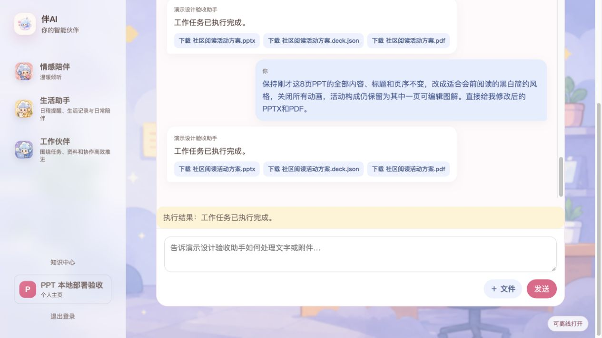

The sample verified **8 pages → 8 pages, retained titles/content/order and all animations removed**. Browser downloads of the original PPTX and revised PDF matched their server-side hashes. [Acceptance record](docs/PRESENTATION_STUDIO.md).

<details>
<summary>See the full-deck plan: structure and pacing for eight training pages</summary>

A separate volunteer-training deck for a community reading activity uses consistent colors, with a layered diagram only on page three and other layouts suited to each page. This capture shows the first six of eight planned pages, not a slide-by-slide gallery of the whole PPT.

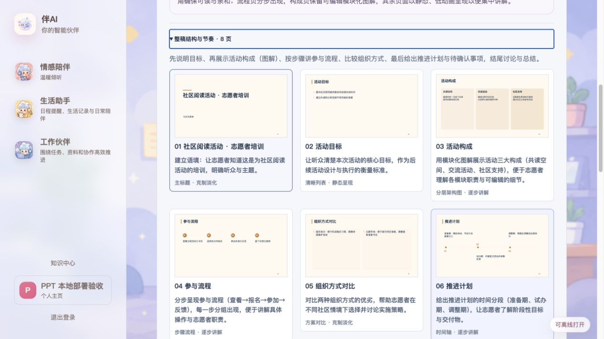

</details>

<details>
<summary>See the workflow: choose a template → edit pages → check and export</summary>

These three captures come from different local acceptance samples, each demonstrating its respective operation.

**Choose a template.** Preview a quarterly review, project proposal or course explanation, then replace placeholders with your own material.

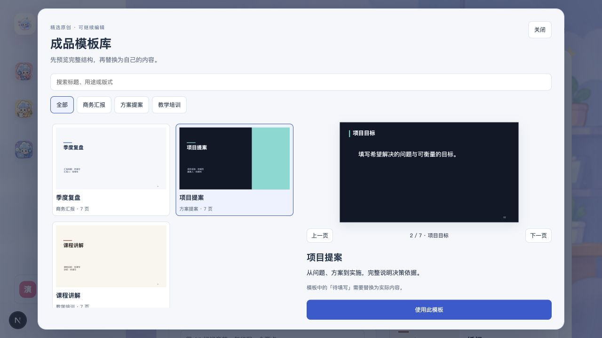

**Refine individual pages.** Change themes and animations, edit titles, text, charts and tables, save versions and rehearse.

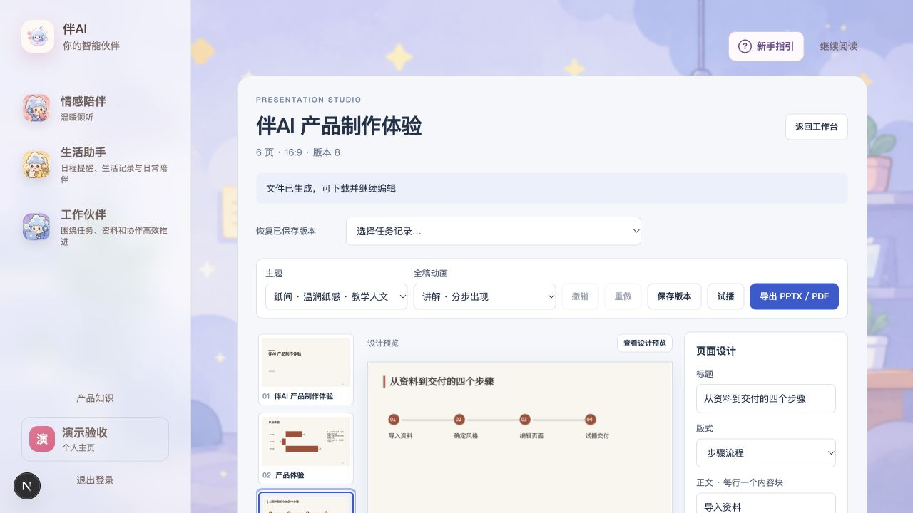

**Check before delivery.** The passed layout-check status corresponds to LibreOffice rendering of the final PPTX. Download PPTX, PDF and the design file. Animation compatibility still needs checking in the target presentation app.

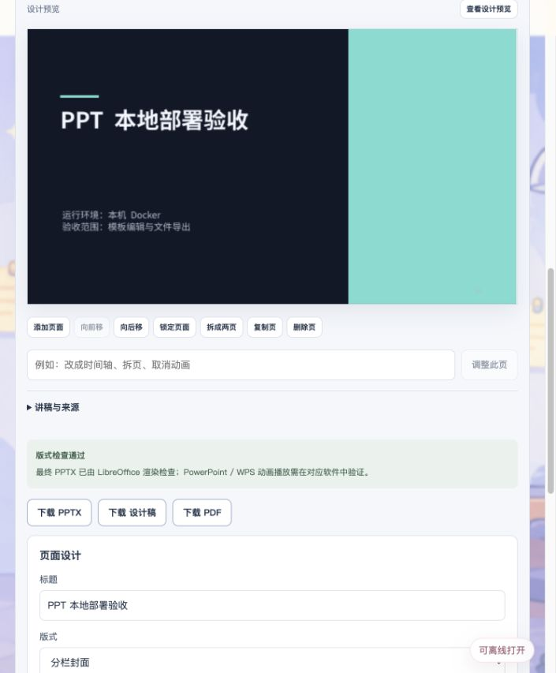

</details>

<details>
<summary>See the product-introduction example: illustrations and a feature table</summary>

The exact prompt sent was:

> 帮我生成一个图文并茂的ppt介绍伴A I，使用表格介绍主要功能

The Work partner invokes the PPT generation Skill and returns `banyai-intro.pptx` in the conversation, with relevant built-in product knowledge available to ground the introduction.

<p align="center">
  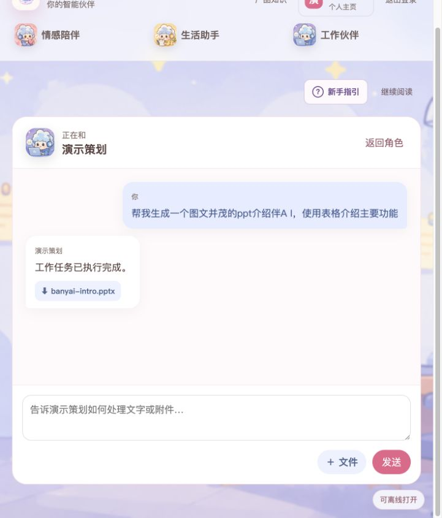
</p>

</details>

<details>
<summary>See more office tools: documents, translation and spreadsheet analysis</summary>

The workbench provides text translation, Markdown documents, DOCX copy editing, PPT Studio, CSV/XLSX analysis forms and Skill controls. PDF translation, attachment reading and email drafts start in Work chat; creating an email draft does not send it.

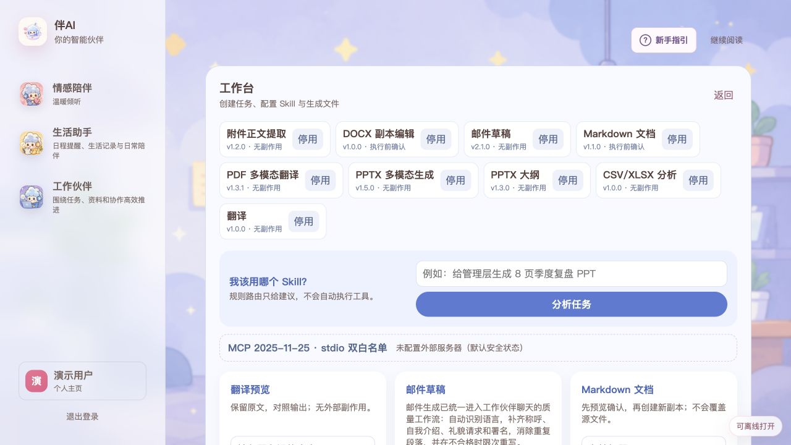

</details>

Drafts are account-scoped in the current browser. Restoration still needs a network connection and available backend services; save the design file before clearing browser data. AI style planning consumes model usage, while manual saves/exports do not replan the style. PDF and export previews require a server-side renderer and CJK fonts. [Creation and recovery steps](docs/GETTING_STARTED.md#制作续改与导出演示文稿).

### Life assistant: records you can find after the conversation

Start an expense or reminder in chat, then verify it in the corresponding page. The samples include a **CNY 18.00 expense** and a reminder titled **“准备 AI Companion 项目演示材料”**.

<details>
<summary>See expense recording: life workspace → confirmation → ledger</summary>

Plans, reminders and spending share one workspace:

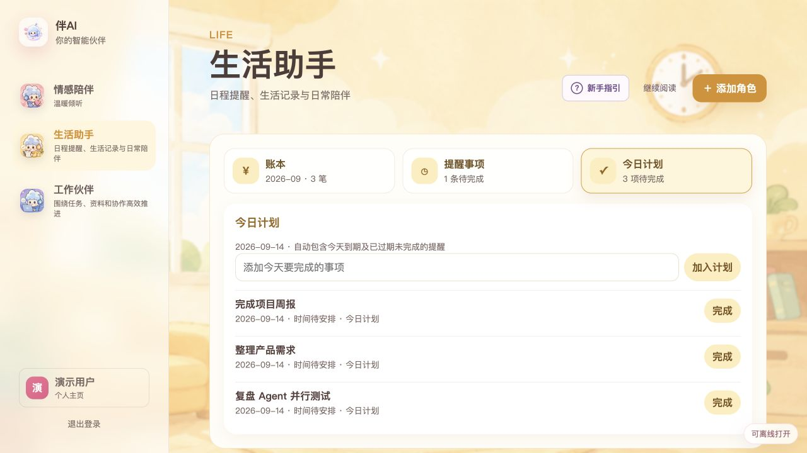

Describe the amount and purpose, then review and confirm the write:

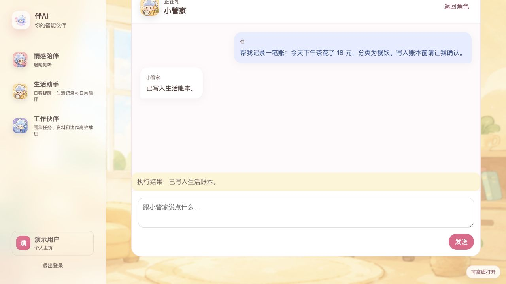

Check the record and monthly summary in the ledger:

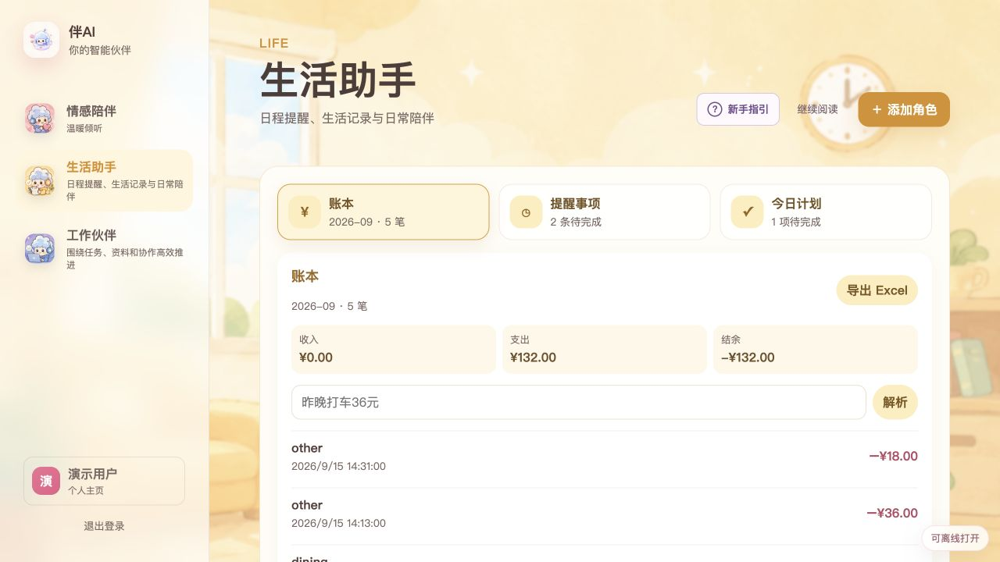

</details>

<details>
<summary>See reminders: creation conversation → reminder result</summary>

First, request the reminder and receive the creation result:

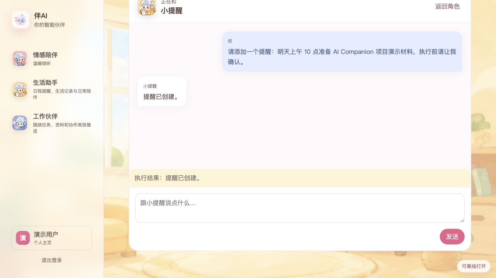

Then verify the title, trigger time and notification channel:

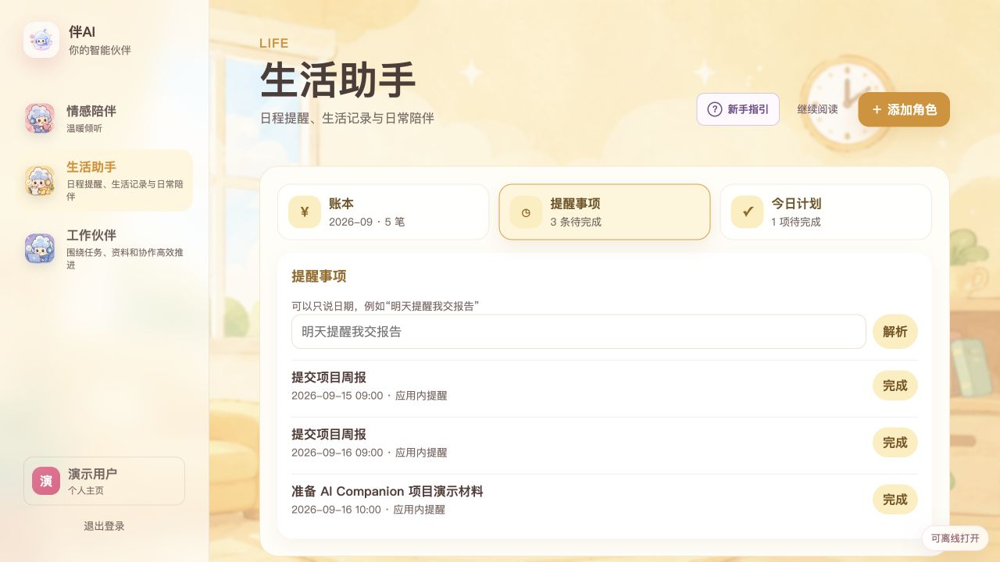

</details>

### Companion: pick up where you left off

The user expresses presentation anxiety, then explains there is too much material and a risk of running overtime. The character follows that context with suggestions for trimming content, timeboxing and rehearsing. Long-term preferences can be inspected and corrected in memory management.

<details>
<summary>See the multi-turn conversation: emotional continuity and presentation preparation</summary>

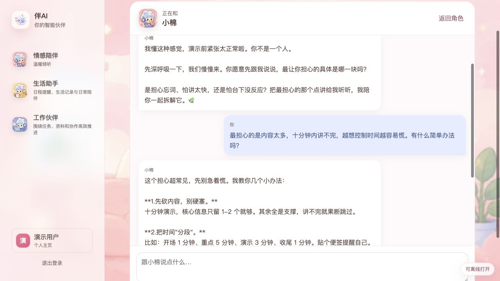

</details>

## Technical highlights

Built around **context engineering, Agentic RAG, multi-Agent collaboration and editable content generation**, with particular attention to source coverage, parallel recovery, evidence validity and continued editing. Implementation baseline: `42694a4`, reviewed **2026-10-14**.

| Design | Engineering problem addressed | Read more |
| --- | --- | --- |
| **Complete large-file chunking** | Finish every source-reading round; stable Source IR IDs, token/character bounds, coverage gates and deterministic merges handle material beyond one model window, with targeted retries | [Chunking design](docs/blog/ppt-generation-vibe-coding/03-large-files-and-intermediate-representation.md) |
| **Bounded multi-Agent parallelism** | Independent attachment reads, dependency-aware research and requested source/expression review; preallocated budgets, retained successful branches and checkpoints avoid duplicate work and lost usage | [Parallelism and resources](docs/PARALLEL_AGENTS.md) |
| **Context and correctable memory** | Shared Go/Python snapshots, sourced summaries and correction chains preserve constraints; full-request window checks protect model calls | [Context management](docs/CONTEXT_MANAGEMENT.md) |
| **Traceable unified knowledge** | Documents, Wiki, memory and product guides share versioned references; durable indexing, ready-key filtering and permission rechecks keep stale indexes or derived summaries from posing as current originals | [Knowledge engineering](docs/KNOWLEDGE_ENGINEERING_IMPLEMENTATION.md) |
| **Evidence arbitration and optional debate** | Check candidate ownership, source versions and literal quotations; isolate first-round judgments and gather evidence read-only, retaining uncertainty and stopping file generation on unresolved research disputes | [Arbitration protocol](docs/ARBITRATION.md) |
| **Editable presentation designs** | `presentation-design-v2` separates facts from visual design; stable page/content IDs support revisions, preview/export share geometry, and the final PPTX is render-checked | [PPT Studio](docs/PRESENTATION_STUDIO.md) |
| **Recoverable, authorized execution** | Go Tool Gateway controls business writes; Runs, idempotency, leases and revision fencing handle cancellation and crashes; admin Passkeys and layered quotas govern access and cost | [Engineering](docs/ENGINEERING.md) · [Quotas](docs/ADMIN_QUOTAS.md) |
| **Documentation as product knowledge** | Allowlisted docs, SHA-256, `go:embed` and local BM25 ship instructions with the app; consistency and help-retrieval tests detect stale guidance | [Knowledge-bundle maintenance](docs/PRODUCT_KNOWLEDGE.md) |

<details>
<summary>Key parameters and verification evidence</summary>

| Pipeline | Default settings and guarantees |
| --- | --- |
| Attachments and composition | Chat uploads default to 20 MiB; Composer batches of 2,000 estimated tokens / 12,000 source characters, concurrency 3 with hard cap 4; finish intake before generation |
| Agent collaboration | 2–3 independent attachment reads, 2–6 research tasks; requested review with at most one revision/recheck |
| Wiki compilation | 24,000 UTF-8 bytes per batch, per-document concurrency 3, at most 64 batches; successful candidates cached for 24 hours; preserve all source pages and mark incomplete semantic coverage when over budget |
| Provider concurrency | 8 shared Go/Python permits by default, requiring reliable same-host shared storage—not distributed cross-host rate limiting |
| Optional debate | Off by default; when enabled, at most 2 rounds, 6 new model calls, 2 read-only evidence queries and a 60-second absolute deadline per Run, within its total budget |

Complete intake means source/entity coverage, not a summary that repeats every detail. Content review is separate from visual PPT validation. Unified retrieval retains a lexical path when semantic models are disabled. Real-model comparative evaluation and production rollout of debate remain pending; simulated tests do not establish accuracy or speedup ratios.

Verification: [chunking and coverage](workers/python/tests/test_agent_runtime.py), [parallelism and recovery](workers/python/tests/test_parallel_tasks.py), [knowledge access and versions](internal/knowledge/service_test.go), [whole-deck revisions](workers/python/tests/test_presentation_whole_deck.py), [product-knowledge consistency](internal/productknowledge/catalog_test.go). See the [engineering challenge matrix](docs/ENGINEERING.md#engineering-challenges-and-solutions) and [historical acceptance records](docs/PROJECT_COMPLETION.md).

</details>

## Architecture and stack

**Web interface + Go business services + independent workers + Python Agent runtime.** Models propose actions and generate content; Go handles identity, authorization and business writes. PostgreSQL stores authoritative state; Kafka is an optional dispatch component.

| Layer | Technologies |
| --- | --- |
| Web | Next.js 16 · React 19 · TypeScript |
| API and business logic | Go 1.26 · OpenAPI · PostgreSQL 18 |
| Agents and processing | Python · LangGraph · PostgreSQL Checkpointer · Versioned Skills |
| Retrieval and files | Qdrant · Redis · MinIO · Source IR · Wiki · Product-knowledge BM25 · python-pptx / LibreOffice |
| Deployment and observability | Docker Compose · Caddy · OpenTelemetry · Prometheus · Loki / Alloy · Optional Langfuse |

[Architecture and processing diagrams](docs/TECHNICAL_GUIDE.zh-CN.md#系统架构) · [Repository map](docs/ENGINEERING.md#repository-map) · [Concurrency settings](docs/TECHNICAL_GUIDE.zh-CN.md#关键并行与分片参数)

## Documentation

Most topic guides are currently in Chinese; the engineering guide is in English.

| I want to… | Start here |
| --- | --- |
| Install, try the app or troubleshoot | [First-run guide](docs/GETTING_STARTED.md) · [Model configuration](docs/OPENROUTER_MODELS.md) |
| Make a presentation or restore a design | [PPT Studio](docs/PRESENTATION_STUDIO.md) |
| Search sources, read originals or submit feedback | [Knowledge Center](docs/KNOWLEDGE_CENTER.md) · [Context and Wiki](docs/CONTEXT_MANAGEMENT.md) |
| Understand chunking, parallelism and verification | [中文技术指南](docs/TECHNICAL_GUIDE.zh-CN.md) · [English engineering guide](docs/ENGINEERING.md) · [Evidence arbitration](docs/ARBITRATION.md) |
| Manage access, quotas or knowledge quality | [Passkeys](docs/ADMIN_PASSKEY_LOGIN.md) · [Quotas](docs/ADMIN_QUOTAS.md) · [Quality review](docs/KNOWLEDGE_CENTER.md#后台知识质量) |
| Deploy, upgrade or check quality | [Runbooks](docs/runbooks/) · [Engineering and release commands](docs/ENGINEERING.md) · [Verification records](docs/PROJECT_COMPLETION.md) |
| Extend or study the implementation | [OpenAPI](api/openapi/openapi.yaml) · [Detailed design](docs/DETAILED_DESIGN.md) · [ADRs](docs/adr/) |
| Report vulnerabilities or review public-release safety | [Security policy](SECURITY.md) · [Historical security review](docs/SECURITY_REVIEW.md) |

<details>
<summary>Updating an existing deployment</summary>

Upgrading older feature versions to unified knowledge requires PostgreSQL migration `000046` / MySQL `000035` and all preceding pending migrations. Handle unfinished Runs before switching Agent graph versions. Documentation/knowledge-bundle updates alone add no migration, but API, Worker, Agent Worker and Web need rebuilding to take effect in a running app. PPT-to-PDF export additionally requires LibreOffice and CJK fonts. See [knowledge maintenance](docs/PRODUCT_KNOWLEDGE.md) and the topic-specific deployment guides.

</details>

## Recent updates

- **2026-10-13** · Expanded Knowledge Center, PPT revision, evidence-review and quality-operations guides, with contextual navigation and product-help retrieval improvements for existing capabilities. [Commit](https://github.com/bamboo-ye/ai-companion/commit/42694a4bc551c6e6cf35d1c570121c33d8808530)
- **2026-10-01** · Integrated PPT Studio, unified knowledge engineering and bounded evidence verification, disabled by default. [Implementation record](docs/PROJECT_COMPLETION.md)

## Get involved

Share use cases and issues through [Issues](https://github.com/bamboo-ye/ai-companion/issues), or improve code, tests, docs and demos through [Pull Requests](https://github.com/bamboo-ye/ai-companion/pulls). Include versions, sanitized reproduction steps and logs. Report vulnerabilities privately under the [security policy](SECURITY.md); never post keys or private material.

After editing the Chinese README or other product-knowledge sources, refresh and check the bundle:

```bash
node scripts/build-product-knowledge.mjs
node scripts/build-product-knowledge.mjs --check
go test ./internal/productknowledge
```

See the [engineering guide](docs/ENGINEERING.md#documentation-maintenance) for full development and validation commands. If AI Companion is useful to you, a Star helps others discover the project.
