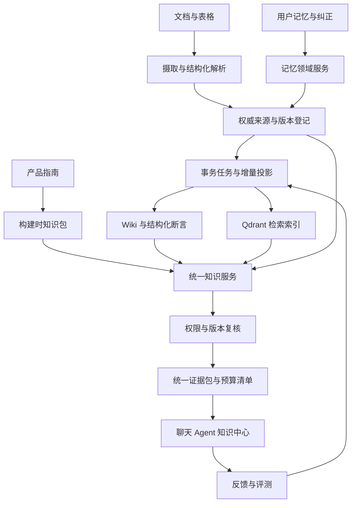

# 伴AI知识工程评审与集成化提升方案

评审日期：2026年9月30日。评审对象：本地工作区，基准提交 `e1ab55d`，包含评审时已有的未提交修改。本文交付代码评审、技术选型、目标架构与实施方案；所述新增服务、数据表、接口和指标门槛均为提案，尚未实施或部署。

**核心结论：项目已具备有来源、可撤销、可恢复的知识处理基础，下一阶段应把文档、Wiki、记忆和产品知识接入统一知识服务，优先消除召回范围截断、查询时批量生成向量和证据契约分散的问题。** 保留 Go 权限与事务边界、PostgreSQL 权威数据、Qdrant 检索索引及 Python 解析和推理能力。先完成可评测的混合检索与增量更新，再按收益引入时态知识关系和多模态检索。

## 评审范围与证据边界

已检查文档解析、Source IR、Qdrant 检索、Wiki 编译及聚合、长期记忆、会话快照、内置知识包、Agent 工具、证据校验、相关迁移与评测入口。本文代码定位对应评审时工作区，后续修改可能改变行号。

未读取生产资料、私有环境变量或生产日志，未调用真实付费模型，未验证生产配置与容量。默认配置的行为不能据此认定为线上行为；模拟模型测试通过也不能证明真实模型质量。下文将代码中确认的行为、由此推断的风险和建议分开表述。

## 当前能力与可复用基础

| 知识类型 | 当前实现 | 集成后应保留的特点 |
|---|---|---|
| 原始文档 | 文件存储、Python 解析、页与 Chunk、Source IR、Qdrant 混合检索 | 原文不可被模型摘要替代；页码、表格结构和覆盖率可追溯 |
| 派生 Wiki | 来源页、主题页、实体页、决策页、版本与人工编辑保护 | 派生页依赖全部来源；过期来源退出检索；冲突保留双方 |
| 长期记忆 | 用户隔离、来源消息、有效期、固定项、显式纠正、仲裁 | 用户纠正的权威性、时间边界和删除语义 |
| 内置产品知识 | 白名单文档生成、构建时嵌入、中文双字词与英文 BM25 | 本地可用、只读发布、不复制到用户知识库、不冒充实时业务状态 |
| 会话上下文 | `conversation-context-v1`、摘要、记忆、产品知识、预算清单 | Go 与 Python 共用快照；参考数据不能改变工具权限 |
| 知识治理 | Wiki 任务租约、重试、版本检查、反馈、证据仲裁、索引灰度 | 失效即拒绝、任务幂等、可回滚、原始证据优先 |

相关入口：[上下文管理](/Users/windcry1/Documents/ai_companion/docs/CONTEXT_MANAGEMENT.md)、[产品知识](/Users/windcry1/Documents/ai_companion/docs/PRODUCT_KNOWLEDGE.md)、[模块化单体决策](/Users/windcry1/Documents/ai_companion/docs/adr/0001-modular-monolith.md)、[数据库优先异步调度](/Users/windcry1/Documents/ai_companion/docs/adr/0005-database-first-async-dispatch.md)。

项目已有任务与 Outbox，已有语义模型适配器和 Source IR。提升方案应扩展这些设施，避免重复建设第二套任务系统、证据存储或会话协议。

## 主要发现与优先级

P1 表示建议在扩大知识库规模或切换检索策略前解决；P2 表示应纳入集成阶段。优先级是工程判断，不代表已确认生产事故或安全漏洞。

| 编号 | 优先级 | 代码中确认的行为 | 影响与处理建议 |
|---|---|---|---|
| K01 | P1 | 个人与团队文档查询先列出最多 200 份文档，再筛选 ready 和指定 ID；SQL 个人列表按创建时间倒序 | 第 201 份及更旧文档可能不在搜索范围，显式指定旧文档也无法越过此上限。显式 ID 应直接批量鉴权；全库搜索改为权限过滤的索引检索及权威数据复核 |
| K02 | P1 | Wiki 先按页面 ID 排序，语义候选仅取前 200 个有效页面；词法路径仍扫描可见页面 | 无词面重合的相关页面在第 201 位后无法进入语义候选。改为持久化的全库语义索引，候选上限应施加在相关性检索之后 |
| K03 | P1 | Wiki 和记忆查询会对缺失向量的内容调用模型，向量仅保存在进程内，15 分钟过期，超过 2048 项时整表清空 | 冷启动、过期与多副本可能重复付费，并增加查询尾延迟。改成后台增量向量生成；查询只生成问题向量，未完成索引时显式降级 |
| K04 | P1 | `legacy` 是默认索引模式，旧 dense 是 256 维哈希词特征；sparse 是哈希词频加对数变换，没有完整 BM25 的文档长度与 IDF 机制 | 默认文档检索不具备训练所得的语义理解。保留为可用性回退；上线语义模式前，用本项目数据选择模型与中文词法策略。内置产品知识已有独立 BM25，不能将两条实现混为一谈 |
| K05 | P1 | `semantic.Client.Version()` 仅包含模型名和维度，集合名与向量缓存据此区分 | 服务端同名模型更新，或更换服务商但保留同名同维度时，可能混用向量空间。新增不可变的模型修订、预处理与查询模板版本，生成索引规格指纹 |
| K06 | P1 | 文档结果只要留下引用就设置 `Sufficient=true`；语义命中跳过词面重合检查；只有启用 reranker 才应用固定 0.2 门槛 | 有相关候选不等于足够回答，尤其在无答案问题上。将“有候选”“证据支持”“存在分歧”拆开；用无答案样本校准各模型门槛 |
| K07 | P2 | `Citation`、`WikiEvidence`、`contextengine.Source`、`EvidenceReference` 分别描述来源；聊天自动上下文和工具检索分开接入 | 跨来源去重、版本复核、统一展示和反馈归因需要多处转换。建立共同证据引用与结果清单，旧接口通过适配器兼容 |
| K08 | P2 | Wiki 聚合使用 `kind + 标准化标题`，显式字段冲突通过键值正则提取；记忆召回最多读取 500 条，具有有效期与替代关系 | 同名实体区分、别名归并、业务范围与历史事实查询不足。引入有范围的实体标识和结构化断言；已有有效期继续保留，逐步补足双时间建模 |
| K09 | P2 | Docling 路径导出逐页 Markdown；Source IR 已保存部分表格结构，但当前 Go 引用主要是 Chunk 与页码 | 图表区域、脚注和表格单元格的统一定位不足。扩展 Source IR 的区域与单元格定位，按问题类型接入视觉检索 |
| K10 | P1 | 上下文检索评测文件仅 5 条合成用例，执行器只调用记忆服务；默认 `min-recall` 为 0 | 该入口未覆盖文档 Qdrant、Wiki、产品知识的联合质量，成功退出不等于质量达标。建立统一知识评测与明确发布门禁 |
| K11 | P2 | 文档摄取先写向量，再保存解析数据；清理器删除当前索引与文件；旧索引保留供回滚 | 有重试基础，但跨存储故障、退役集合残留和历史副本清理仍需统一核对。增加索引投影登记、对账与删除清单，区分立即禁止读取和异步物理清理 |

代码依据：

- K01：[文档查询](/Users/windcry1/Documents/ai_companion/internal/document/retrieval.go:50)、[PostgreSQL 文档列表](/Users/windcry1/Documents/ai_companion/internal/persistence/postgresstore/document.go:101)。ready 筛选发生在截取之后，因此未完成的新文档还可能挤占候选范围。
- K02：[Wiki 排序](/Users/windcry1/Documents/ai_companion/internal/document/wiki.go:224)、[语义候选上限](/Users/windcry1/Documents/ai_companion/internal/document/wiki.go:263)。此外 Wiki 来源枚举还有 10000 份文档上限，大规模检索应取消对全量列表的依赖。
- K03：[Wiki 向量计算](/Users/windcry1/Documents/ai_companion/internal/document/wiki_vectors.go:15)、[记忆向量计算](/Users/windcry1/Documents/ai_companion/internal/memory/semantic.go:17)。Wiki 向量只编码标题和前 1600 字，长页后部信息也可能丢失。
- K04：[默认配置](/Users/windcry1/Documents/ai_companion/internal/platform/config/config.go:811)、[哈希向量](/Users/windcry1/Documents/ai_companion/internal/document/retrieval.go:172)、[Qdrant 索引](/Users/windcry1/Documents/ai_companion/internal/document/qdrant.go:38)。
- K05：[模型版本](/Users/windcry1/Documents/ai_companion/internal/semantic/client.go:71)、[集合与灰度](/Users/windcry1/Documents/ai_companion/internal/document/index_rollout.go:19)。
- K06：[答案与引用](/Users/windcry1/Documents/ai_companion/internal/document/retrieval.go:136)、[重排](/Users/windcry1/Documents/ai_companion/internal/document/retrieval.go:270)。Wiki 的 0.5 余弦阈值与词法分数加权也需要独立校准，不能解释为正确率。
- K07：[会话快照](/Users/windcry1/Documents/ai_companion/internal/conversation/context_snapshot.go:32)、[共享上下文契约](/Users/windcry1/Documents/ai_companion/internal/contextengine/context.go:23)、[已有证据校验](/Users/windcry1/Documents/ai_companion/internal/document/evidence.go:22)。
- K08：[Wiki 聚合](/Users/windcry1/Documents/ai_companion/internal/document/wiki_aggregate.go:40)、[记忆召回](/Users/windcry1/Documents/ai_companion/internal/memory/service.go:179)。模型保存记忆时的固定 `Confidence=.99` 是实现常量，不是经校准的事实正确概率。
- K09：[Docling 导出](/Users/windcry1/Documents/ai_companion/workers/python/src/ai_companion_worker/document_parser.py:229)、[Source IR 构造](/Users/windcry1/Documents/ai_companion/workers/python/src/ai_companion_worker/document_parser.py:468)。
- K10：[评测数据](/Users/windcry1/Documents/ai_companion/evals/context/retrieval.v1.json)、[评测执行器](/Users/windcry1/Documents/ai_companion/cmd/context-eval/main.go:30)。
- K11：[摄取次序](/Users/windcry1/Documents/ai_companion/internal/document/ingest.go:127)、[清理器](/Users/windcry1/Documents/ai_companion/internal/document/cleanup.go:65)。这是故障一致性与保留策略改进项，不能据此断言当前已发生越权召回。

## 本次验证结果

八个相关 Go 包的测试均通过：`contextengine`、`semantic`、`document`、`memory`、`productknowledge`、`conversation`、`chattool`、`arbitration`。最初受沙箱构建缓存及本机监听限制影响；使用临时构建缓存并允许测试监听本机后完成。模拟接口测试覆盖的是程序契约。

离线执行 `go run ./cmd/context-eval --offline` 得到：

| 项目 | 结果 | 解释 |
|---|---|---|
| 总用例 | 5 | 4 条正向召回，1 条删除约束 |
| 通过 | 2 | 中文词面匹配和删除不召回通过 |
| Recall@5 | 0.25 | 4 条正向样例仅命中 1 条 |
| MRR | 0.25 | 命中样例位于第 1 位 |
| 跨语言及改写 | 3 条未命中 | 在本次关闭 embedding 的词法基线中出现 |
| 模型调用 | 0 | 不包含真实模型质量、延迟或费用测量 |

这组数据只能证明当前合成记忆用例的词法基线较弱，不能外推成全项目问答准确率。测试中的零毫秒是毫秒粒度下的本地耗时，不能作为线上性能证据。本次未开展真实 PostgreSQL/Qdrant 联调、负载测试、Python 全量测试或真实模型回放；真实 Qdrant 用例需要单独的 `QDRANT_TEST_URL`。

## 最新技术的选择与落点

检索核对日期为 2026年9月30日。下表结合当前官方资料与近年成熟方法；早期方法标明原始年份，不将其包装为新发布。采用顺序是针对本项目的工程建议，未承诺厂商基准成绩可直接迁移。

| 技术 | 核实到的能力 | 本项目建议 |
|---|---|---|
| Qdrant 混合与多阶段检索 | Query API 可组合 dense、sparse、RRF 与分阶段重排；多表示检索可分别使用标题、摘要与正文 | 近期采用，复用现有 Qdrant；用相关性选候选后再限制数量，保留来源类型与权限过滤。[官方说明](https://qdrant.tech/documentation/search/hybrid-queries/)、[多表示检索](https://qdrant.tech/documentation/tutorials-search-engineering/multi-representation-search/) |
| Contextual Retrieval | 2024 年提出的做法是为切片补充其在原文中的解释性上下文，再进入向量和关键词索引 | 先用标题、章节、时间、表头等确定性字段补全；模型补充的上下文另存为派生字段，引用仍指向原文。需要本地消融验证。[Anthropic 原文](https://www.anthropic.com/engineering/contextual-retrieval) |
| 多语 embedding 与 reranker | Qwen3 文本系列提供检索和重排模型 | 可将 0.6B 级模型作为部署成本较低的候选，与当前提供商做同数据对比；检查查询指令、维度与分数输出适配，不假定模型可直接兼容现有 `/rerank` 协议。[官方发布](https://qwenlm.github.io/blog/qwen3-embedding/) |
| 结构化文档表示 | DoclingDocument 能保存文本、表格、图片、层次、边界框与来源信息 | 近期扩展现有 Source IR；保存结构化 JSON，向下兼容已有 Markdown 消费者。锁定版本后做适配测试。[官方数据模型](https://docling-project.github.io/docling/concepts/docling_document/) |
| 多模态检索 | 2026年1月发布的 Qwen3-VL-Embedding/Reranker 支持文本、图片、截图及混合输入；ColPali 是页面视觉多向量检索的研究基础 | 后续对扫描件、图表密集 PDF 和 PPT 做独立试点。Qwen3-VL 的共享向量方案与 ColPali 的多向量方案分别测内存、吞吐和效果，不将二者当成同一种索引。[Qwen 发布](https://qwen.ai/blog?id=qwen3-vl-embedding)、[官方代码](https://github.com/QwenLM/Qwen3-VL-Embedding)、[ColPali 论文](https://arxiv.org/abs/2407.01449) |
| 时态知识图谱 | Graphiti 支持增量事件、实体关系、双时间与混合检索 | 先借鉴时间和来源模型，在 PostgreSQL 中落地有范围的实体与断言；仅在复杂关系查询有明确收益时评估独立图后端。保留本项目显式纠正规则。[官方说明](https://help.getzep.com/v2/graphiti/getting-started/overview) |
| GraphRAG 与 DRIFT | DRIFT 使用社区信息启动搜索，再做局部追问扩展 | 作为跨资料研究模式的可选策略；普通事实问答继续走有界混合检索。图关系与社区摘要必须继承原始证据权限。[Microsoft 文档](https://microsoft.github.io/graphrag/query/drift_search/) |
| 按需上下文 | Context engineering 强调高价值上下文选择、按需读取和长期任务状态管理 | 延续现有 Wiki search/read 与全文覆盖率机制，将预算、来源及缺口统一报告。[Anthropic 工程说明](https://www.anthropic.com/engineering/effective-context-engineering-for-ai-agents) |

近期默认选择是 PostgreSQL 加 Qdrant。仅为“集成化”迁移到 pgvector、引入另一套搜索引擎、图数据库或托管记忆平台，会增加迁移与运维成本；是否采用应由容量和质量实验决定。微调适合后续稳定的抽取或排序任务，频繁变化的业务事实继续放在可更新、可撤销的知识层。

## 目标架构

集成化应落实为四项共同能力：统一知识对象、统一检索和读取接口、统一生命周期、统一质量与运营视图。原文、人工事实、模型推断、业务实时结果仍明确区分。

该图表示职责，首期仍在现有模块化单体中实现，不要求增加微服务。Go 统一处理授权、版本、预算与发布；Python 处理解析、抽取和模型计算；数据库任务队列负责可靠执行，Kafka 继续保持可选。

### 模块与依赖

建议新增 `internal/knowledge`，只依赖中立契约和 Provider 接口。文档、记忆、产品知识通过应用组装层注册适配器；避免它们与 knowledge 包互相导入。`internal/semantic` 继续负责模型调用，`contextengine` 继续负责上下文与预算。

| 职责 | 提案 | 与现有实现的关系 |
|---|---|---|
| 统一检索 | `knowledge.Search` | 聚合 document、wiki、memory、builtin 的候选，统一去重与结果清单 |
| 原文读取 | `knowledge.Read` | 调用现有来源读取及分页能力，返回准确 locator 与内容版本 |
| 证据验证 | `knowledge.Validate` | 扩展现有 `ValidateEvidence`，加入记忆、团队来源、区域引用 |
| 路径追踪 | `knowledge.Trace` | 解释 Wiki 或断言来自哪些原文，逐层检查权限与版本 |
| 索引生命周期 | 索引规格登记、投影状态、任务对账 | 复用现有 ingest、Wiki job、cleanup、backfill、lease 和 Outbox |
| 运营管理 | `/v1/ops/knowledge/...` | 汇总现有 context metrics，增加质量、积压、成本与版本视图 |

### 统一证据与知识对象

建议以 `KnowledgeRef` 作为轻量引用，避免把全部来源正文复制到新表。引用至少包含 `kind`、`source_id`、`source_revision`、`fragment_id`、`content_hash`、`locator`；`locator` 支持页码、章节、文本区间、表格行列、图片区域。没有精确位置的旧资料显式标记定位粒度，不伪造坐标。

`EvidenceItem` 在引用之外描述内容、原始出处、派生关系、业务生效时间、校验状态、召回路线及排序分数。区分以下维度：

- `content_revision`：原始内容或人工编辑版本。
- `policy_revision`：可见性、共享或授权状态版本。
- `index_spec_id`：模型、维度、归一化、分词、查询指令、切片与上下文补全版本。
- `compiler_revision`：Wiki、实体或断言的生成逻辑版本。

模型名与维度相同也不代表同一个 embedding 空间。索引规格使用不可变、无凭证的配置标识和模型修订；无法取得模型修订时使用明确的运营部署版本，不将密钥或带凭证 URL 放入标识。

新增数据结构按阶段引入：`knowledge_sources` 保存对领域数据的引用和版本；`knowledge_dependencies` 保存派生依赖；`knowledge_index_specs` 与 `knowledge_projections` 保存索引规格和进度；后期再增加 `knowledge_entities`、`knowledge_claims` 和 `knowledge_claim_evidence`。用户资料的原始权威数据仍由所属领域模块维护。内置知识包用只读适配器提供，可省去数据库复制。

断言使用“主体、谓词、值、单位、范围、有效起止时间、系统记录时间、来源引用、状态”。例如“项目A正式预算100万元”和“项目A草案预算120万元”先按项目、币种、适用阶段及时间区分，再判断冲突。上传较晚不自动意味着事实更新；用户偏好更正仍必须走已有显式纠正流程。

### 统一接口与兼容方式

提案接口为 `POST /v1/knowledge/search`、`POST /v1/knowledge/read`、`POST /v1/knowledge/validate`、`POST /v1/knowledge/feedback`。这些路径目前未新增，`/v1/knowledge/builtin/...` 继续保留。

搜索请求包含 `query`、`source_kinds`、`document_ids`、`workspace_id`、`mode`、`as_of`、`limit`、`budget`。用户身份和模块能力来自认证会话，客户端传入的 ID 或来源类型只能缩小允许范围。`as_of` 为后期时间查询能力，首期不支持时应明确返回能力限制。

响应除 `hits` 外提供 `manifest`：检索策略版本、索引规格、来源版本、各路候选数、截断和遗漏原因、降级项、时间与 Token 消耗、证据充分性状态。`supported`、`insufficient`、`disputed`、`unknown` 不能只由相似度阈值决定；确定性校验与有界的支持性判断分别记录。

旧 `work_query_documents`、`work_wiki_search/read/follow_links`、`product_knowledge_search/read` 先委托新服务并转换为原返回结构。这样可以逐步迁移前端和 Python，不迫使已有 Agent 定义、检查点及工具协议同时升级。会话快照首期增加可选字段，保留 v1 读取能力；确需破坏兼容时再发布 v2 并提供转换。

## 检索策略与授权边界

先建立三种工作模式，避免所有请求都进入复杂 Agent 循环。

| 模式 | 示例 | 处理方式 |
|---|---|---|
| 事实查询 | 某条要求、某个参数、个人偏好 | 来源路由、关键词与语义检索、融合、重排、证据验证 |
| 全量处理 | 完整翻译、覆盖每一行的报告或 PPT | 使用已有全文分轮读取与覆盖率门禁；Top-K 不能证明完整 |
| 跨资料研究 | 多来源对比、变化原因、实体关系 | 在事实查询基础上做有限轮问题分解、关系扩展与仲裁；限制总调用和成本 |

账本余额、提醒状态、任务完成情况等实时业务问题由现有业务工具查询。知识检索可以说明概念和历史背景，但不能替代权威业务读接口，更不能把文档中的操作描述当成已执行证明。

建议事实查询流程为：服务端求取允许范围 → 多路生成候选 → 候选权威复核 → RRF 融合与原文去重 → 有界重排 → 读取来源 → 再次检查版本与权限 → 组装证据包。送入外部 reranker 或生成模型之前，候选必须已通过当前权限检查。

每路先召回 40～80 个候选、融合后重排 20～40 个、最终保留 5～12 项，可作为实验起点，均受总预算约束。这些是待调参数，不是性能承诺。产品帮助问题优先本地知识包；需要跨来源回答时按任务分配预算，防止同一文档的原始片段、摘要和 Wiki 页面重复占满上下文。

同一基础证据的多种表示按来源版本与定位去重。不同时间或范围的冲突证据必须并存，不能用相似文本去重消掉其中一方。不同召回器的原始分数不可直接比较；先使用排名融合，再用项目标注数据校准决策。小型产品知识包继续本地 BM25，无需强制远端 embedding。

权限规则保持并强化：

- 私人记忆默认仅本人可见；团队共享必须明确授权，不能因文档在团队内就共享用户记忆。
- 现有陪伴、生活、工作模块能力边界继续由服务端执行。统一入口不使陪伴模块自动获得私人文档读取能力。
- Wiki、断言、图路径和社区摘要必须满足其全部依赖的权限交集。混合权限资料不能先合成完整摘要，再只删掉不可见引用。
- Qdrant 过滤与租户字段用于缩小候选；PostgreSQL 当前权限与内容状态仍是最终裁决。大工作空间可增加作用域投影及 payload 索引，避免每次枚举所有文档 ID，具体分片策略按容量决定。[Qdrant 多租户说明](https://qdrant.tech/documentation/manage-data/multitenancy/)
- 缓存绑定用户、工作空间、模块能力、权限版本、来源版本、索引规格和查询策略。权限变化后立即拒绝旧内容，不能等待缓存 TTL。
- 检查点恢复、二次模型调用和最终交付前重新验证证据。已经发送给模型的内容不能由新索引删除来撤回，历史对话和检查点有独立保留与清理流程。

## 统一增量更新与删除流程

将“解析可用”“检索可用”“Wiki 综合完成”拆成不同状态，避免一个 `ready` 掩盖部分能力未完成。对用户显示来源已保存、解析中、可检索、知识整理中、需处理等状态；机器记录 `parsed`、`indexed`、`compiled`、`degraded`、`tombstoned` 及每项投影进度。

1. 原始来源创建、修改、共享变化或删除，与领域状态、知识变更记录及持久任务在同一事务提交。复用数据库优先调度，不强制部署 Kafka。
2. 后台按内容哈希复用解析与向量工作。幂等键包含来源 ID、内容版本、索引规格和阶段；租约令牌与来源版本共同阻止旧任务覆盖新结果。
3. 向量生成、关键词索引和 Wiki 编译独立重试。索引只保存投影，新投影完成并核对版本后再发布；未完成时使用明确回退并报告状态。
4. 内容版本变动使派生页、断言和旧证据失效；权限变动优先更新授权状态。对账任务比较权威来源、任务进度与全部活跃索引规格，补偿丢失投影并清理孤立记录。
5. 删除先写 tombstone 并禁止新读取，再异步清理向量、缓存、Wiki、断言、文件及退役索引。tombstone 保留足够时间阻止迟到任务重新发布已删除内容。
6. 删除清单单独记录历史聊天、Agent 检查点、导出制品、日志和备份的保留策略。能够立即禁用的内容与需要延迟清理或无法撤回的外部副本分别报告。

新方案将当前“先写向量再保存解析结果”逐步改为“权威来源已提交，后台维护可重建索引投影”。不要求跨 PostgreSQL 和 Qdrant 做分布式事务，依靠版本约束、幂等任务和对账完成一致性。

## 统一知识中心与运营视图

产品侧将资料、Wiki、记忆和产品指南汇入知识中心。搜索结果明确标出来源类型、适用范围、当前版本、有效时间和原文入口，提供“为什么找到”“证据是否完整”“有哪些分歧”。保留各来源现有编辑权限，产品指南仍只读，个人记忆默认私有。

知识详情页展示来源与派生关系、原文位置、索引状态、人工修改状态及重新处理入口。反馈按“错误、过期、缺失、引用不支持、权限问题”分类并绑定答案、来源版本与检索策略。负反馈生成复核任务，不直接自动改写权威事实。

运营侧集中观察任务积压、索引覆盖率、更新延迟、错误率、缓存效果、模型费用和质量回归。复用既有日志、追踪和额度系统，新增 `knowledge.ingest`、`knowledge.retrieve`、`knowledge.rerank`、`knowledge.validate` 等阶段记录；默认记录 ID 与指标，避免全文进入运营日志。

成本拆分为摄取、检索、编译、重排与生成。关注每万片段初始索引成本、每千次查询成本、增量更新成本，以及每个有效且有证据答案的成本。本文未采集实际用量和服务商价格，因此不给出货币费用估计。

## 分期实施与代码落点

以下为排期估算：按两名熟悉现有项目的工程师及共享测试支持，主线约 5～8 周；具体取决于语料、模型服务、数据库兼容要求和现有在途修改。多模态与复杂图查询试点单独估算。阶段名称与上文问题优先级含义不同。

| 阶段 | 估算 | 交付与代码落点 | 完成条件 |
|---|---|---|---|
| 第一阶段 评测与范围修复 | 约 1 周 | K01、K02、K05、K06 的回归样例；文档指定 ID 查询修复方案；索引规格与证据契约定稿；统一评测骨架 | 能稳定复现并检测 200/201 文档、200/201 Wiki 页、500/501 记忆边界；不把无答案当充分 |
| 第二阶段 统一入口 | 约 1～2 周 | 新增 `internal/knowledge` 与适配器；修改 chattool、context_snapshot、HTTP 组装入口；兼容旧工具 | 同一问题有统一 manifest，所有来源类型可读可追踪；模块和团队隔离用例全部通过 |
| 第三阶段 持久索引与生命周期 | 约 2～3 周 | 扩展 Qdrant 投影、索引规格、数据库任务、回填和清理；支持 Wiki 与 memory 后台生成向量 | 查询无批量内容 embedding；多副本不重复生成同版本投影；删除、乱序、重试、回滚通过故障测试 |
| 第四阶段 质量门禁与界面 | 约 1～2 周 | 统一知识中心、反馈分类、质量报表、灰度与回滚入口；上下文相关 CI | 盲测与容量目标达标，旧客户端与检查点兼容，运维可定位坏来源与坏索引版本 |
| 后续试点 时态与多模态 | 另估 | 结构化实体断言、区域引用、Qwen3-VL 或 ColPali 试点、有限图扩展 | 专项任务显著优于第三阶段基线，权限、延迟和成本合格后才扩面 |

建议按可独立审查的变更拆分：证据契约与测试；权限范围与引用充分性；统一检索适配器；索引规格与后台投影；变更失效与清理对账；评测和运营；知识中心。当前工作区存在大量在途改动，实施时应先识别归属及依赖，避免将其一起纳入知识工程变更。

数据库以项目已有 PostgreSQL 主线为准。若仍支持 MySQL，新增结构须同时提供迁移与 Store 行为测试；不能默认移除兼容。迁移编号需按实施时仓库最新序列分配。涉及既有工具协议或 Agent 图版本的变更，应遵循当前检查点和在途运行兼容策略。

## 灰度与回滚

在已有 `legacy / shadow / semantic` 基础上新增知识服务路由开关与策略版本。此处开关名称和具体配置留待第一阶段契约定稿，不表示当前已存在。

先增量建表和双写投影，再后台回填；校验来源数量、权限、内容版本、模型规格和失败任务，最后进入影子读取。影子检索也需要独立预算，避免同时串行执行旧、新检索拖慢用户请求。对每个来源类型记录差异与漏检，不只比较第一名 ID。

按用户或工作空间稳定分桶，从小流量逐步扩到全量，每档均检查质量、成本、延迟与删除测试。撤销权限后仍返回内容、引用指向过期来源、乱序任务使删除复活等确定性失败应立即停止放量。

回滚切回旧路由及旧索引规格，保留新增权威数据、源版本与 tombstone；旧读取路径也必须执行当前权限和删除规则。不要用回滚恢复已撤销的内容。新集合保留至回滚窗口结束，再由登记清单清理；删除任务始终覆盖全部保留集合。数据库回滚优先采用停用新增能力，避免破坏性删表。

## 评测与验收

建议先建立至少 300 条经授权、脱敏和人工标注的质量样例，划分调参与冻结盲测集合；额外设置至少 100 条权限、删除、版本和恢复场景。按来源文档、会话或项目划分集合，避免同源改写同时进入训练式调参与盲测。

质量样例应覆盖中文、跨语言、改写、编号精确匹配、无答案、相互矛盾、时间变化、长文后半段、表格、产品说明与真实业务状态区别。容量样例至少覆盖 201 份文档、201 页 Wiki、501 条记忆，以及 1 万和 10 万片段规模；后两者为规划测试规模，不是已测容量。

| 验收项 | 建议门槛或测试方法 | 性质 |
|---|---|---|
| 权限与删除 | 所有确定性隔离与撤销用例通过；不得把未授权文本送入重排或生成模型 | 硬门禁，测试通过不等于证明所有实际场景安全 |
| 版本与引用 | 返回引用均能定位到当前允许使用的指定版本原文；生成上下文不能伪装成直接引文 | 硬门禁 |
| 全量任务 | 需要完整来源的任务达到对应 Chunk、行或页面覆盖率 100%；无法完成则显式阻断完整性声明 | 硬门禁 |
| 召回 | 有答案子集 Recall@20 初始目标 ≥0.85，并逐来源报告；重要子集不能回退 | 待真实标注集校准，非当前成绩 |
| 排序 | nDCG@10 相对既有最佳基线提高，建议争取 ≥10% 相对提升 | 实验目标，报告置信区间与样例数量 |
| 支持性 | 人工抽样的引用支持率目标 ≥95%；不将“引文存在”当成“结论得到支持” | 质量目标 |
| 无答案 | 分开报告错误作答率与误拒答率；初始目标错误作答率 ≤5%，同时观察覆盖率 | 需按任务风险和数据分布校准 |
| 变更可见性 | 权限撤销在权威事务提交后，新读取不可返回旧资料；后台索引更新延迟另计 | 硬门禁与运营指标分开 |
| 延迟 | 先测旧路径 p50/p95；同硬件、同数据、同并发比较，初始目标新路径 p95 增幅 ≤20% | 规划目标，分别报告冷热缓存、纯检索和完整答案 |
| 增量处理 | 无积压时，小文本变更检索可见性 p95 可先以 60 秒为目标；大文件按规模分档 | 待容量验证 |
| 成本 | 查询只生成问题向量；相同内容与规格只生成一次持久投影；单位有效答案成本不超过约定预算 | 成本归因与去重验收 |

采用固定语料与相同问题，分别关闭语义、重排、上下文补全和关系扩展做消融实验；报告每项收益和附加成本。模型评审可辅助发现错误，发布盲测必须保留人工判断；不能使用生成答案的同一个模型自评后就视为通过。

将 `min-recall` 等发布阈值显式写入专用 CI 任务；无真实模型或数据库时将结果标记为 skipped，不能用离线成功退出替代 live 门禁。真实模型回放固定模型修订、提示词和索引规格，并保存逐例证据与失败分类。

## 近期建议决策

近期优先投入统一证据与检索服务、持久化增量索引和真实质量评测。以当前 PostgreSQL、Qdrant、Source IR 和任务体系为基础推进，把图谱与视觉检索作为可插拔的后续策略。

第一批交付应让开发者能回答三个具体问题：某条知识为什么被找到，它来自哪个仍有效的原文版本，原文更正或撤销后哪些结果会立即失效。具备这些能力，再扩大知识库规模和推理复杂度，收益才能被测量和持续维护。
