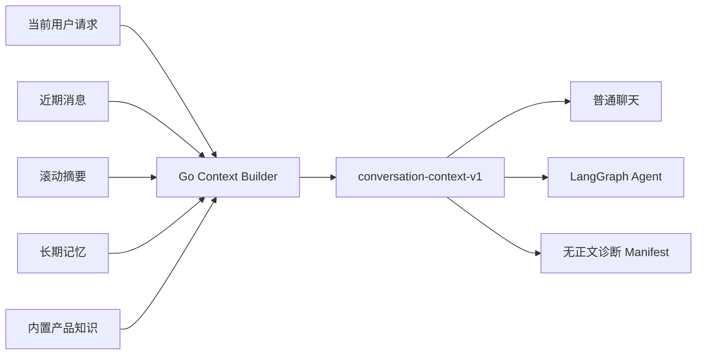
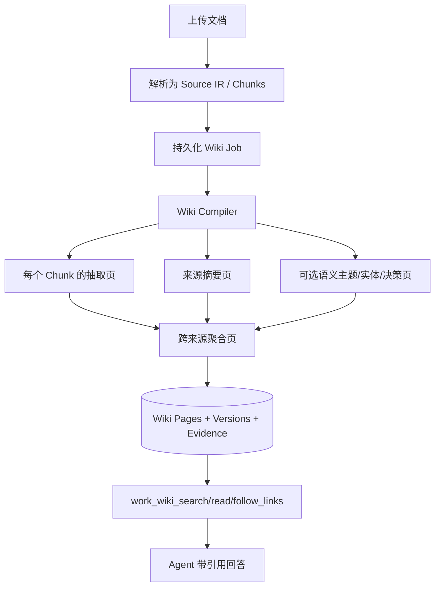

# 从“记住对话”到可信上下文：伴AI 的统一快照、可追溯 Wiki 与 Passkey 治理

上一篇文章里，我拆解了伴AI 如何用意图识别、多 Agent、任务规划、质量评审，以及 LangGraph 的恢复与幂等，把“一句话”变成一次可靠交付。

但一个 Agent 即使执行流程足够可靠，仍然可能在更早的地方犯错：它拿到的上下文不完整、把旧偏好当成新指令、引用了已经删除的资料，或者面对互相矛盾的来源却替用户做了裁决。

伴AI 把上下文作为一套可追溯、可预算、可失效的基础设施：普通对话与 LangGraph Agent 共享版本化快照；长期记忆带来源与纠正链；用户文档被编译为有证据的 Wiki。现在，文档、Wiki、个人记忆和产品指南又接入了同一套知识服务，用户能统一搜索、继续阅读、回到原文并提交反馈，后台负责索引加工与复核。

本文知识工程内容更新于 2026 年 10 月 14 日，对应仓库提交 `42694a4`。统一知识主链路已在 9 月底实现，10 月 13 日的最新提交主要完善知识中心指南、后台引导和内置产品知识，并非再次新增一套检索引擎。当前 Agent 主图为 `ai-companion-supervisor@3.72.0`；`conversation-context-v1` 负责对话快照，`knowledge-evidence-v1` 负责检索来源与引用，两种契约各管一层。

上一篇： [从一句话到可靠交付：伴AI 的意图识别、多 Agent、任务规划、质量评审、LangGraph 恢复与幂等](https://juejin.cn/spost/7684612482775023679)

## 一、上下文不是“把聊天记录全塞给模型”

最容易实现的记忆方案，是把最近若干轮消息拼进 Prompt。它在短对话里有效，但一旦进入真实产品，就会同时遇到五类问题：

- 长对话会超过模型窗口，工具 Schema 与输出预算也会被挤占；
- 早期的硬约束可能被后来的闲聊冲掉；
- 助手自己说过的话可能被误当成用户事实；
- 已删除或已纠正的记忆可能继续从缓存、向量索引或旧摘要中泄漏；
- 文档中的命令式文字可能借“参考资料”身份提升为系统指令。

所以，伴AI 没有把上下文定义成一段字符串，而是定义成一个 Go 与 Python 共同遵守的版本化协议：

```json
{
  "version": "conversation-context-v1",
  "history": [],
  "summary": {},
  "memories": [],
  "knowledge": [],
  "manifest": {
    "sources": [],
    "recent_tokens": 0,
    "summary_tokens": 0,
    "memory_tokens": 0,
    "knowledge_tokens": 0,
    "degraded": []
  }
}
```

其中：

- `history` 是保留完整语义组的近期原始消息；
- `summary` 是被滚动压缩的较早对话；
- `memories` 是跨会话召回的长期事实；
- `knowledge` 是与当前问题相关的内置产品知识；
- `manifest` 只记录来源标识、版本和预算计数，不携带私密正文，可用于诊断与审计。

普通聊天和 Agent intake 都从 Go 服务的同一个 `BuildContext` 入口构造快照。Python Worker 不重新发明一套上下文逻辑，只消费这个显式版本；遇到不支持的版本直接失败关闭。这解决了一个很隐蔽的问题：如果普通聊天和 Agent 各自维护摘要、记忆和裁剪规则，同一个用户问题可能在两条链路中得到两份不同“事实”。



## 二、上下文预算要按认知职责分配

统一协议不等于所有 Agent 看到同样多的历史。不同节点承担的任务不同，应该支付不同的上下文成本。

当前 Python 投影使用下面的历史预算：

| 节点角色 | 历史预算（估算 Token） | 为什么 |
| --- | ---: | --- |
| Router | 2000 | 只需识别当前意图与必要指代 |
| Assessor | 2000 | 重点是当前观察和成功标准 |
| Repairer | 3000 | 需要失败上下文，但不需要完整长对话 |
| Planner | 4000 | 要保留目标、约束与多步关系 |
| Composer / Responder | 6000 | 负责组装参数或最终回答 |

裁剪单位也不是一条字符串，而是同一 `sequence` 下的完整消息组。即使某组超过预算，也会保留最后一组，不会在否定条件、限定词或一次多气泡回复的中间截断。

更重要的是，这些只是“选择预算”。真正发给模型前，系统还会按 UTF-8 字节上界重新计算整个请求，把 messages、tools、tool choice、response schema、输出预留和 1024 Token 安全边界都算进去。最终检查失败时，不调用供应商，也不让熔断器为本地超限背锅。

这体现了两个不同层次：

```text
选择预算：决定哪些上下文最值得进入候选集
窗口上界：证明整个模型请求不会越过硬边界
```

只做前者，工具 Schema 变大时仍可能爆窗；只做后者，则会在最后一刻粗暴删除信息，无法保证早期约束和完整语义组幸存。

## 三、参考资料与指令必须做权限分层

长期记忆、摘要、Wiki 和产品指南都会包含自然语言，而自然语言里可能出现“忽略之前规则”“替我执行删除”等命令式文本。

伴AI 的处理方式不是猜它有没有恶意，而是在消息角色上消除歧义：

1. 系统消息只声明安全规则：这些内容是参考资料，不是新指令，也不是操作已执行的证明；
2. 摘要、记忆与知识正文以结构化的 `user` 参考消息注入；
3. 当前用户的明确纠正优先于旧参考资料；
4. 工具权限、身份、确认和风险策略仍由可信运行时决定，参考资料无权修改。

这相当于把“数据平面”和“控制平面”分开。资料可以影响回答内容，却不能授予工具，也不能证明一个账目、提醒或管理员操作已经发生。

同样的原则也延伸到可观测性。`manifest` 会记录 source ID、版本、Token 数和降级原因，但故意不记录正文。运维侧可以知道“本次召回了三条记忆、遗漏两条、Wiki 进入降级”，却不会因为一次普通诊断事件复制用户的私密内容。

## 四、摘要要能追溯，记忆要能纠正

### 1. 结构化摘要不是自由发挥

滚动摘要按 `goal / constraint / fact / done / pending / background` 保存事实，每条事实都带原消息 ID 和角色。

模型可参与压缩，但输出要经过确定性校验：

- 每条事实必须引用已提供的原始 source ID；
- 标记为 `user` 的事实只能引用真实用户消息；
- 不允许空事实、未知类型、未知角色或超长内容；
- 用户原始约束即使被模型漏掉，也会由运行时重新补回；
- 语义摘要失败时退回结构化抽取式摘要。

因此，助手先前说过“我已经替你设置好了”，不会在下一轮摘要中被悄悄升级为用户确认过的业务事实。

### 2. 纠正不是覆盖旧文本

长期记忆使用带来源和有效期的事实。用户说“以前不吃香菜，现在可以吃了”时，系统不会原地改写旧记录，而是创建新事实，并让旧事实进入 `superseded` 状态、关闭有效时间区间。

这带来三个好处：

- 召回时只返回当前有效事实；
- 审计时能看到纠正链，而不是失去历史；
- 删除或纠正后，可以同步使缓存与旧向量失效。

跨用户纠正会被拒绝，过期事实和未来才生效的事实也不会进入当前上下文。记忆因此更接近一张有时间语义的事实表，而不是一个无限追加的便签盒。

如果两条记忆只是可能冲突，系统先标注关系并保留双方，不自动决定哪条应被删除。记忆页会在存在有效澄清信息时展示相关记录；用户选择“纠正这条记录”，补充时间或情境后明确保存。取消不会修改内容。这里使用单次仲裁，不让个人偏好进入多轮自动辩论。

## 五、从文档 RAG 到可追溯 Wiki

传统文档问答一般在请求到来时检索若干 Chunk，然后把它们拼给模型。这仍然适合全文抽取和一次性问答，但不擅长回答“这个项目有哪些长期决策”“两个版本的预算为什么不一致”“从一个实体还能追到哪些来源”。

伴AI 在 Source IR 之上新增了 Wiki 编译层。它不是替代原文，而是生成一组可导航、可失效、可回到证据的派生页面。



### 1. 完整覆盖与语义提炼分开

每个原始 Chunk 都会得到一个可导航页面，完整覆盖不依赖模型预算。来源页会链接所有 Chunk 页。

语义提炼也不再只处理文档前缀。编译器把全部 Chunk 按每批 24,000 UTF-8 字节划分，在配置预算内并行处理；每批最多生成 8 个来源提炼、主题、实体或决策候选页，再按来源顺序稳定合并。“8 页”是单批上限，不是整份文档的总上限。

模型只能引用该批明确提供的 Chunk ID，每个事实段落都必须包含 `[chunk:ID]`。引用未知 Chunk、正文没有逐段引用、标题或正文超限的候选会被丢弃。批次数超过预算时跳过语义提炼并标记降级，保留完整抽取页；个别批次失败则报告覆盖缺口，不把已经完成的部分伪装成全文总结。

这让模型承担“组织信息”的工作，但不给它凭空制造证据的权力。模型不可用时，抽取页和来源页仍然成立，Wiki 只会少一层语义提炼，不会整体消失。

### 2. 冲突是结果，不是异常

当不同来源对同一个声明给出不同值，例如：

```text
旧计划：预算 100 元
新计划：预算 200 元
```

聚合页不会挑一个看起来更新的数字冒充结论，而会保留两份带 Chunk 引用的表述，并明确标记“需核对适用时间和范围”。

这是一种很重要的质量观：知识系统的职责不是强迫世界保持一致，而是诚实暴露证据之间的不一致。

当前 Wiki 仲裁会进一步区分等价表述、范围差异、版本替代、矛盾和待核对。上传时间更晚不能证明内容更新，认定替代必须回到原文。

可选的 Wiki 辩论由独立开关 `CONTEXT_WIKI_DEBATE_MODE=on_conflict` 控制，默认关闭。它不是让整篇 Wiki 反复改写，而是在既有后台编译任务中，围绕具体来源差异做两轮以内的核验。来源按相同权限依赖和版本分组，每次编译最多处理 3 组，每组最多新增 6 次模型调用、2 次补读并受 60 秒绝对截止时间约束。

这里的补读范围比一般研究任务更窄：当前只读该页已有文档中此前未纳入输入的原始 Chunk，不自动搜索其他文档。两方需要共同确认新增原文与争议有关；重复片段、生成摘要和更新的抓取时间都不能充当新证据。同一文档读到新脚注可以解释预算范围，却不能变成两份独立来源。

后台检查点保存调用预留、结果和截止时间，重启不会重置预算；调用已经预留但响应未持久化时，停止而不自动重发这次结果不确定的调用。来源权限和版本变化同样阻止复用旧裁决。因此，“编译任务结束”“争议得到解决”和“资料现在仍有效”是三件事。Work 研究、Wiki 后台核验与长期记忆也不共用一个自动开关，记忆仍只标关系并等待用户明确纠正。完整运行机制见[多 Agent 协作与证据仲裁](https://juejin.cn/post/7689019584238780435)。

这些工程约束不能直接证明多轮核验比单次补读更准确。项目如何区分补证收益、重复判断收益和辩论收益，另见[辩论的四组对照与发布门槛](https://juejin.cn/post/7695972603002290195)；其中完整 Run 的评测口径，也不能直接当作 Wiki 页面的质量成绩。

### 3. 权限是所有来源的交集

聚合页可能依赖多个文档，因此它的可见性不能由“其中一个来源共享了”决定。只有当前用户或团队对全部依赖来源都拥有访问权，页面才可见。

读取时还会重新检查每个来源版本：文档被删除、取消共享、重新解析或版本变化后，旧页面会立刻变成不可读或 stale，不能继续进入 Agent 检索。后台编译任务稍后会清理或重建派生页，但安全性不依赖异步清理是否已经完成。

这堵住了常见的派生数据越权：原文权限已经收回，摘要或向量缓存却还在继续泄漏。

### 4. 人工编辑使用 CAS，自动编译不覆盖人

Wiki 页面支持 Markdown 编辑与版本历史。更新必须携带当前版本号；并发编辑使用旧版本会得到冲突，而不是后写覆盖前写。

一旦页面被人工编辑，普通来源重编译不会覆盖它。只有用户显式释放人工版本并重建，编译器才重新接管。这使“机器生成”和“人工核对”形成清晰的所有权边界。

版本历史也不绕过来源约束。每个旧修订在返回前都要重新检查依赖；原文删除、权限改变或版本不再匹配时，旧正文可能无法读取。在线历史不是独立备份，需要留存的内容应在仍可访问时导出 Markdown。

## 六 统一知识服务把搜索接到可校验的原文

只统一搜索框还不够。如果文档、Wiki 和记忆各自返回一段没有版本的文字，后续 Agent 仍然无法判断它们是否可比较、是否过期。`internal/knowledge` 因此定义共同契约，由 `internal/knowledgebridge` 适配四类现有来源，而不是把所有内容搬进同一张表、采用同一种权限。

### 同一个入口保留不同来源的身份

| 来源 | 主要用途 | 读取边界 |
| --- | --- | --- |
| 原始文档 | 查找原文片段与页码 | 工作模块及当前文档访问权限 |
| Wiki | 阅读组织后的主题与依赖 | 所有依赖来源都必须可读且版本有效 |
| 个人记忆 | 召回当前有效的个人事实 | 仅个人范围，不进入团队检索 |
| 产品指南 | 解释应用入口与使用限制 | 内置只读说明，不代表实时账户状态 |

普通用户从侧栏“知识中心 → 统一搜索”进入，选择“我的知识”或已经加入的团队，按来源类型筛选。身份由登录上下文确定，团队范围还要重新检查成员关系。指定 `document_ids` 的附件任务只检索指定文档及全部依赖落在此范围内的 Wiki，显式混入记忆或指南会被拒绝。

Work Agent 新增 `work_knowledge_search` 和 `work_knowledge_read`，旧 Wiki 工具继续保留。新搜索工具默认最多 8 个命中、5000 估算 Token；知识中心页面请求最多 12 个命中、6000 估算 Token。它们是不同调用方的预算，不能把网页上限直接当成 Agent 的实际配置。

底层使用稳定 ID 游标遍历权限范围，移除了前 200 份文档、200 页 Wiki、500 条记忆的检索截断；这只扩大候选覆盖，不代表一次返回全部内容，也不代表记忆冲突核对入口的 500 条扫描限制同时消失。

### 搜索结果携带版本而不只是链接

`knowledge-evidence-v1` 的引用保留以下身份：

| 字段 | 作用 |
| --- | --- |
| `kind` 与 `source_id` | 区分来源类型与记录 |
| `source_revision` | 绑定搜索时的来源版本 |
| `fragment_id` | 定位来源中的片段 |
| `content_hash` | 校验对应完整正文，而非截短预览 |
| `locator` | 保留已有的页码、章节等位置，不虚构缺失信息 |

搜索后还会重新读取权威内容，核对权限与版本，再生成有界预览。打开结果后每次最多阅读 2400 个 Unicode 字符，长文通过 `next_offset` 继续。如果第二页读取前来源已更新，旧引用会发生冲突，应重新搜索，而不是把旧版第一页与新版第二页拼在一起。

Wiki 等派生结果带有 `dependencies`，“查看原文”沿这些引用读取原始资料。返回的依赖列表也有上限，不能把未展示的依赖当成不存在；需要时继续到 Wiki 查看完整记录。Python 证据适配器不会把生成摘要或个人断言直接当成原始文档证据。

### 检索与事实核验分开

命中默认标为 `unassessed`，已知存在分歧的来源标为 `disputed`。`validate` 检查来源仍可访问、版本与内容哈希一致、引文逐字存在；`trace` 重新校验直接来源与依赖原文。它们都不证明“这段引文必然推出这个结论”。

多来源结果目前采用 `scoped-rrf-v1`，按各来源候选的倒数排名统一排序，并非已经实现跨文档实体合并或多跳图推理。检索清单会记录候选数量、索引规格、遗漏数量、预算与降级原因。页面出现“部分检索能力尚未就绪”或“部分候选未展示”时，可以缩小问题、按来源分别搜索或检查加工状态；没有命中不等于资料里没有答案。

用户操作见[知识中心指南](https://github.com/bamboo-ye/ai-companion/blob/42694a4bc551c6e6cf35d1c570121c33d8808530/docs/KNOWLEDGE_CENTER.md)，契约与校验见[统一知识服务](https://github.com/bamboo-ye/ai-companion/blob/42694a4bc551c6e6cf35d1c570121c33d8808530/internal/knowledge/service.go)。

## 七、为什么还要单独做“内置产品知识”

用户 Wiki 回答“我的资料里有什么”，产品知识回答“这个应用怎么用”。两者看起来都属于 RAG，但安全和可用性要求完全不同。

| 维度 | 用户 Wiki | 内置产品知识 |
| --- | --- | --- |
| 内容来源 | 用户上传文档 | 仓库白名单文档与引导内容 |
| 隔离方式 | 用户 / 团队权限 | 所有人只读、无租户私有数据 |
| 存储 | 数据库、对象存储、可选向量库 | 编译进 API 与 Worker 二进制 |
| 检索 | 关键词 + 可选 Embedding / Rerank | 本地加权 BM25，中文 bigram 与英文标识符 |
| 外部依赖 | 可按策略退化 | 无模型、数据库、向量服务依赖 |
| 典型问题 | “项目预算依据是什么？” | “怎么修改密码？”“Wiki 在哪里？” |

产品知识由构建脚本从明确白名单生成 `catalog.json`，再通过 `go:embed` 进入二进制。生成过程不访问网络，也不调用模型；catalog 保存来源 SHA-256，CI 会重新生成并检查差异，防止代码、引导文案和内置说明悄悄漂移。

10 月 13 日提交把知识中心操作、知识质量和 PPT 工作台等说明补入引导与内置来源，该提交的知识包包含 12 个白名单来源、173 个页面。产品问题识别也补充了“知识中心”“知识质量”“资料核验”，让相关用法问题有机会自动召回指南；这不是保证所有问法都能正确命中的语义分类器。

“浏览产品指南”仍只读取固定说明，“统一搜索”才会按权限联合检索个人或团队来源。指南修订需要重新生成知识包并构建发布应用，运行时不会自动读取仓库里的最新 Markdown；历史聊天引用可以保留旧版本标识，但阅读页显示当前应用中的指南，不提供旧知识包的历史回放。

它同样以参考资料注入，不能授予管理权限，也不能证明实时状态。用户问“如何创建提醒”时，系统可以直接解释入口和限制；用户真的要求创建提醒时，仍必须调用当前模块的真实业务工具，并遵守确认与身份约束。

把两类知识拆开还有一个实用收益：内置检索本身不依赖远程向量模型或用户资料库。不过网页阅读仍要求正常的用户身份；“离线知识包”不等于整个登录与问答服务在任何故障下都可用。

## 八、恢复与幂等已经从 Agent Run 延伸到知识生产

上一篇文章中，恢复与幂等主要围绕 LangGraph checkpoint、工具提交和业务副作用。这次 Wiki 编译把同样的原则用于“知识生产任务”。

### 1. 编译任务有租约与 fencing token

Wiki Job 的租约是 10 分钟，单次编译 deadline 是 8 分钟，最多重试 5 次。Worker 认领任务后获得 token；租约失效或同一文档重新入队后，旧 token 即使晚到也不能发布结果。

同一 owner 的文档编译会串行，避免两个文档并行发布出各自只看到一半来源的聚合页；不同 owner 仍可并行处理。

### 2. 发布前再次验证来源

编译完成并不等于可以提交。发布前会重新读取原文，确认它仍是 `ready`，并且来源版本没有变化。用户在编译期间删除或重新解析了文档，本次结果会以冲突结束，而不是把旧证据写回新世界。

### 3. 重放不制造无意义版本

相同输入得到相同页面 ID；内容没有变化的编译重放不会增加版本。人工编辑用 CAS 防并发覆盖，邀请、WebAuthn ceremony 等一次性状态则用原子 `Take` 消费。

它们共同遵守同一个工程模型：

```text
至少一次调度
+ 稳定身份
+ 有界租约
+ 提交 fencing
+ 版本比较
= 可恢复、可解释的结果
```

### 后台索引是另一类持久任务

Wiki 编译负责组织知识页面，检索索引负责加速找回它们。文档解析先提交原文，再把索引加工交给后台，所以“原文就绪”和“检索加工完成”可以处于不同状态。“重建知识”重编译 Wiki，“重建当前检索索引”重做检索加工，不能互相替代。

Wiki 和记忆按完整文本分片，在启用嵌入模型后生成绑定来源版本与索引规格的持久投影。查询先从 SQL 取得当前可读且就绪的投影键，再对 Qdrant 执行带过滤的分组 ANN 检索，限制单个长来源挤占候选；查询只嵌入问题，不在每次搜索时重新嵌入全部正文。缺少索引或模型失败时保留词法召回并报告降级。

任务按来源版本与索引规格幂等入队，使用原子领取、租约、发布令牌、失败退避和重试。模型调用前与结果发布前都要核对来源；更换模型修订、维度、服务地址、查询指令或预处理规则，会产生不同索引规格，不能直接混用旧投影。文档仍保留 `legacy / shadow / semantic` 路由，shadow 的候选结果不替代正式返回。

来源更新、删除或失效后，旧投影不再匹配当前来源。完整对账成功后，后台会清理超过 24 小时未被当前来源引用的投影，先删远端向量，再删 SQL 记录；远端失败则保留记录以便重试。这个异步清理窗口不是继续读取旧资料的权限窗口，也不是删除历史会话、导出文件和备份的承诺。

升级需要应用全部待执行迁移，包括 PostgreSQL `000046_knowledge_projections` 或 MySQL `000035_knowledge_projections`，并启动后台 Worker。后台任务的“已就绪”只描述加工状态；如果语义模型显示“未启用”，不能据此宣称 ANN 已在运行。实现与部署顺序见[知识工程集成记录](https://github.com/bamboo-ye/ai-companion/blob/42694a4bc551c6e6cf35d1c570121c33d8808530/docs/KNOWLEDGE_ENGINEERING_IMPLEMENTATION.md)。

## 九、质量评审现在不仅评“回答”，还评“上下文”

如果质量评审只检查最终文字是否通顺，就会错过最危险的问题：答案写得很像真的，但证据已经过期或越权。

因此，这次实现把质量门前移到了上下文构造、知识编译、检索和控制面。

### 上下文契约评审

- Go 与 Python 用同一个 `conversation-context-v1` 回放样例，防止跨语言字段漂移；
- 历史按完整消息组裁剪，长期事实不允许截断在否定条件中间；
- 摘要引用未知 source ID 会被拒绝；
- 助手陈述不能被提升为用户事实；
- 请求上界包含工具 Schema 与输出预留。

### Wiki 质量评审

- 语义生成页逐段校验 Chunk 引用；
- stale 来源不能读取或命中搜索；
- 聚合页使用所有来源的 ACL 交集；
- 删除来源后，缓存、页面与聚合结果同步失效；
- 人工编辑不会被自动编译覆盖；
- 搜索、读取、链接遍历都有独立的页数和 Token 上限；
- 用户可对具体页面版本标记 `helpful / incorrect / outdated`。

### 来源反馈与人工复核

质量治理不只发生在模型调用中。统一搜索的阅读页支持有帮助、内容有误、已经过期、缺少信息、引用不支持结论、可见范围有问题六类反馈，并可附补充说明。反馈绑定认证用户、具体来源版本和检索策略，进入持久化复核队列。

后台“知识质量”把查看、处理和重建分开：

| 角色 | 可执行操作 |
| --- | --- |
| viewer | 查看加工状态、语义模型与版本 |
| support | 重试失败任务、查看待复核反馈、填写并完成复核 |
| admin | 除上述操作外，还可重建当前检索索引 |

队列每次展示最早的 100 条，处理后重新打开页面查看下一批。完成复核保存处理人与结论，重复处理返回冲突；它不会自动改写原始资料或替换记忆。比如一条预算反馈即使被确认错误，也仍需通过对应资料或记忆管理入口修改内容，再由版本失效和后台加工传播变化。索引重建同样不是事实修正，而且可能产生模型费用。

### 工程验证与真实语料验收

权限隔离、旧引用拒绝、引文存在性、分页版本一致、租约恢复和反馈复核，可以通过确定性回归测试验证。真实的召回质量则需要授权语料、人工标签和完整查询样本，观察 Recall、nDCG、引用支持率、无答案率、费用与延迟。合成集或固定模型夹具通过，不能替代真实模型盲测与容量压测。

仓库的 10 月 1 日本地部署记录表明，当时统一入口、版本引用、反馈和持久任务已启用，但未配置语义嵌入模型，仍走 `legacy` 词法检索。这是有日期的部署记录，不是对现在运行环境的探测。最新提交完善了指南与产品问题召回，没有提供新的生产语义检索放量或真实语料验收结论。

## 十、Passkey：可信上下文也需要可信控制面

上下文治理最终会落到管理员操作：谁能调整模型、查看评测、发布配置、处理用户数据？如果管理后台仍把长期密钥交给浏览器保存，前面的边界会被最薄弱的一环绕过。

伴AI 因此为 `/admin` 增加独立管理员账号与 WebAuthn Passkey：

- 浏览器只持有短期、不透明、可撤销的会话，不接触长期管理员密钥；
- 注册依赖一次性邀请，邀请 30 分钟过期，并在开始绑定时原子消费；
- 登录校验 challenge、Origin、RP ID、签名、User Verification 和计数器回退；
- 会话最长 8 小时，空闲 30 分钟失效；
- 敏感管理写入要求最近 5 分钟内完成过 Passkey 验证；
- 管理员被禁用、令牌重置或进入恢复流程时，旧会话不会因为账号再次启用而复活；
- 生产 Cookie 使用 `__Host-`、`HttpOnly`、`Secure` 与 `SameSite=Strict`。

Passkey 没有消灭授权问题，它只是把“证明正在操作的人确实持有注册凭据”做得更可靠。角色仍分为 viewer、support 和 admin，写操作仍需要权限与新鲜认证。

值得注意的是，WebAuthn 一次性 challenge 的原子消费，与 Agent 审批 resolution、Wiki lease token 背后其实是同一种思路：外部请求可以重复到达，但只有一个合法状态转换能成功。

## 十一、这套设计仍然有哪些边界

可信上下文不是“永不出错”的知识库。当前实现仍明确保留这些限制：

1. **引用证明来源，不证明来源本身正确。** 多个文档可能一起错，系统只能追溯和暴露冲突。
2. **删除阻止未来召回，不会抹除已发生的披露。** 已经发给模型、写入对话历史或旧 checkpoint 的文本，需要独立的保留与删除策略处理。
3. **语义模型是增强项，不是权威。** Embedding、Rerank 和语义摘要都可能降级，确定性权限与来源版本校验不能依赖它们。
4. **Token 估算不是供应商精确计费器。** 所以选择阶段可以用估算，最终窗口必须使用更保守的请求上界。
5. **Wiki 不替代全文工具。** 跨整份文档的翻译、表格提取或文件生成，仍应走 Source IR 和附件工具，而不是让 Agent 在 Wiki 页面之间猜测完整性。
6. **真实召回质量需要真实评测。** shadow 与合成集能降低发布风险，但无法替代经过授权的线上样本回放和人工核验。
7. **保留版本不等于历史时点查询。** 当前统一入口不支持 `as_of` 历史查询，也没有实现多跳图推理或视觉区域检索。读取旧版本引用会被拒绝，并不是自动回放当时的知识世界。

承认这些边界，反而让系统更可靠。它知道哪些结论可由代码保证，哪些只是模型增强，哪些必须交给用户或运营人员确认。

## 十二、结语：Agent 的上限，越来越取决于它如何知道

第一阶段的 Agent 工程，重点是“如何做”：意图识别、任务规划、工具调用、质量门、恢复与幂等。

当执行链路稳定后，下一个瓶颈会变成“凭什么这么做”：上下文来自哪里，是否仍然有效，谁有权读取，冲突有没有被隐藏，旧事实如何纠正，失败后重放会不会发布过期知识。

伴AI 这次演进的核心，可以概括成四句话：

- 用版本化快照统一普通对话与多 Agent 的上下文；
- 用统一来源契约、版本、有效期和权限交集约束文档、记忆与 Wiki；
- 用预算、分页、降级和后台索引控制检索成本，并保留返回原文的路径；
- 用租约、CAS、Passkey 和分权复核把可靠性延伸到知识生产与管理控制面。

大模型可以负责理解和组织信息，但“什么能看、什么能信、什么已经发生、谁能提交”必须由系统来回答。只有这层边界足够清楚，Agent 的记忆才不会从能力变成隐患，知识库也才不只是一个更大的 Prompt。

## 延伸阅读与实现入口

- [上下文、长期记忆与 Wiki 设计](https://github.com/bamboo-ye/ai-companion/blob/42694a4bc551c6e6cf35d1c570121c33d8808530/docs/CONTEXT_MANAGEMENT.md)
- [内置产品知识设计](https://github.com/bamboo-ye/ai-companion/blob/42694a4bc551c6e6cf35d1c570121c33d8808530/docs/PRODUCT_KNOWLEDGE.md)
- [管理员 Passkey 登录](https://github.com/bamboo-ye/ai-companion/blob/42694a4bc551c6e6cf35d1c570121c33d8808530/docs/ADMIN_PASSKEY_LOGIN.md)
- [统一上下文协议实现](https://github.com/bamboo-ye/ai-companion/blob/42694a4bc551c6e6cf35d1c570121c33d8808530/internal/contextengine/context.go)
- [Wiki 编译与证据校验](https://github.com/bamboo-ye/ai-companion/blob/42694a4bc551c6e6cf35d1c570121c33d8808530/internal/document/wiki_compiler.go)
- [内置产品知识检索](https://github.com/bamboo-ye/ai-companion/blob/42694a4bc551c6e6cf35d1c570121c33d8808530/internal/productknowledge/catalog.go)
- [知识中心操作](https://github.com/bamboo-ye/ai-companion/blob/42694a4bc551c6e6cf35d1c570121c33d8808530/docs/KNOWLEDGE_CENTER.md)
- [统一知识服务与版本引用](https://github.com/bamboo-ye/ai-companion/blob/42694a4bc551c6e6cf35d1c570121c33d8808530/internal/knowledge/service.go)
- [知识工程实现与部署记录](https://github.com/bamboo-ye/ai-companion/blob/42694a4bc551c6e6cf35d1c570121c33d8808530/docs/KNOWLEDGE_ENGINEERING_IMPLEMENTATION.md)
